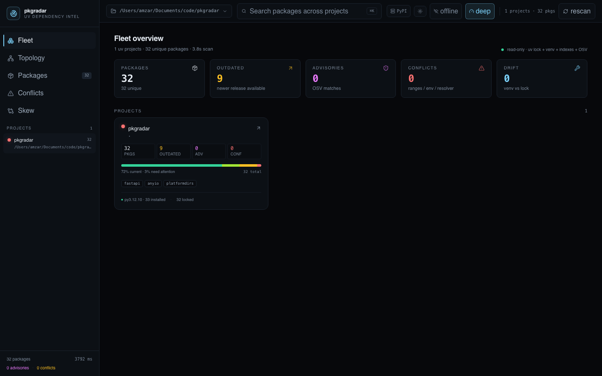
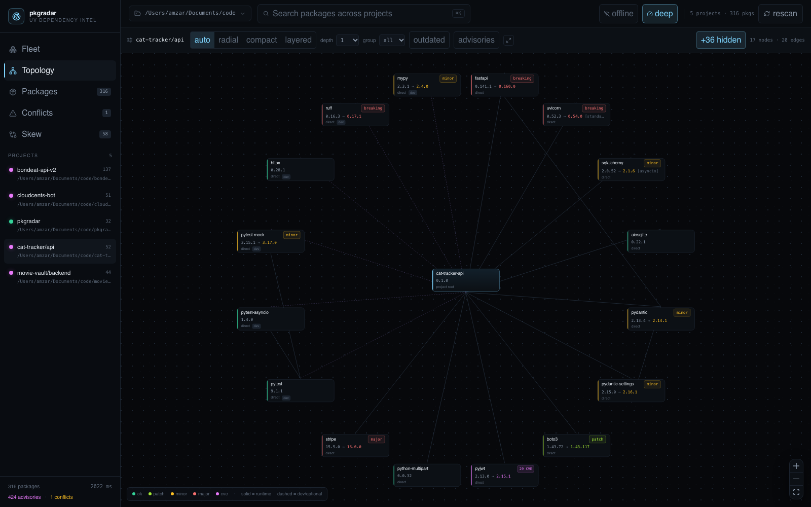
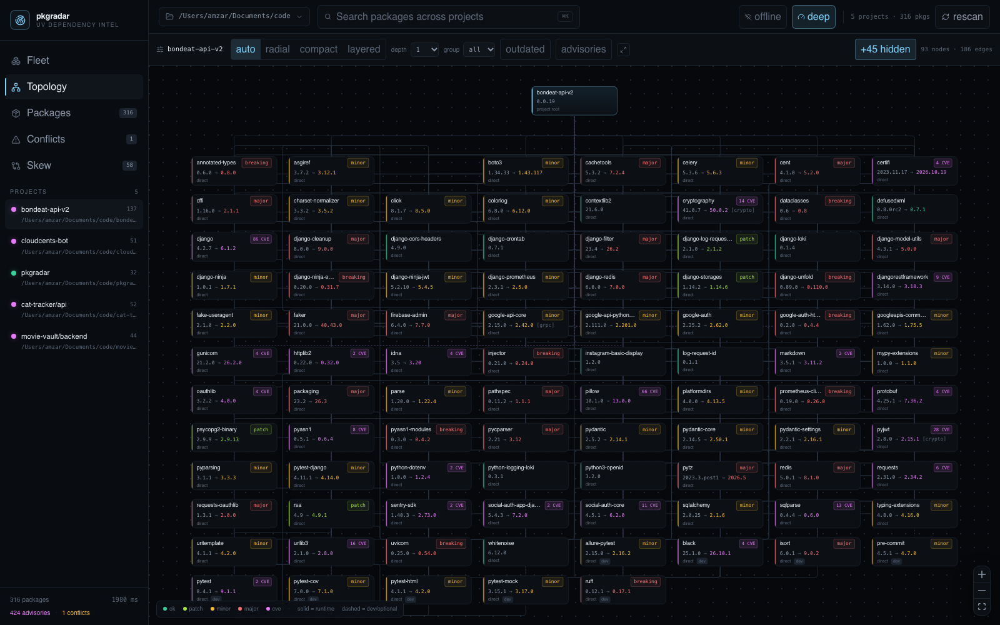
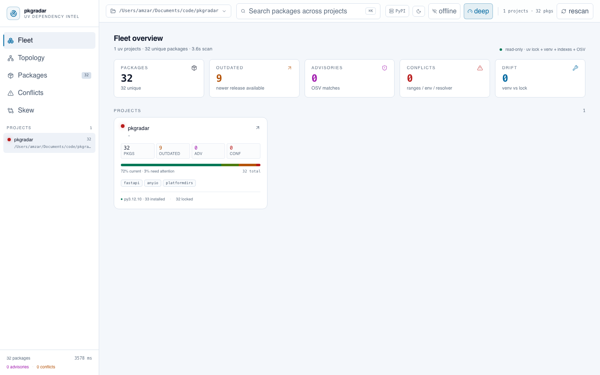
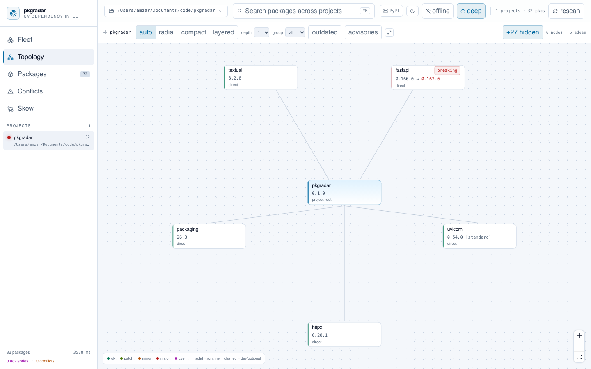
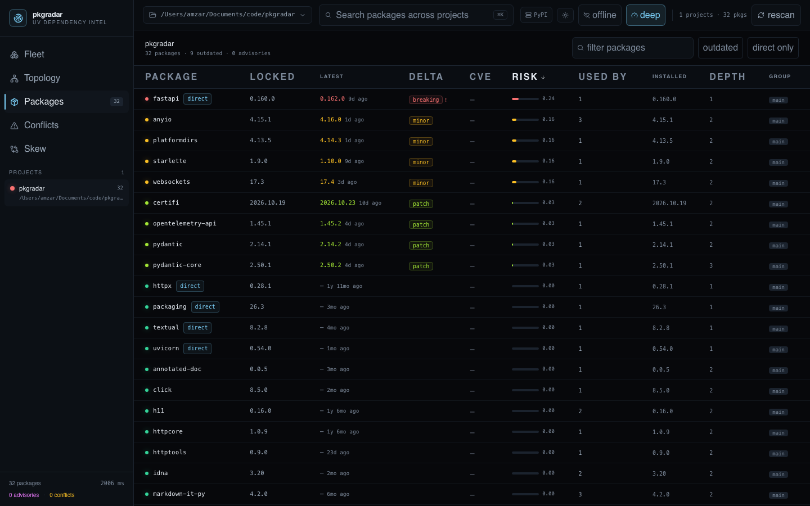
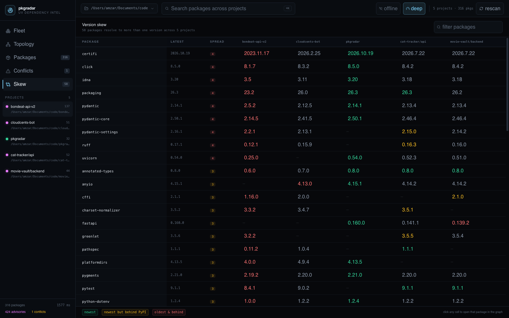
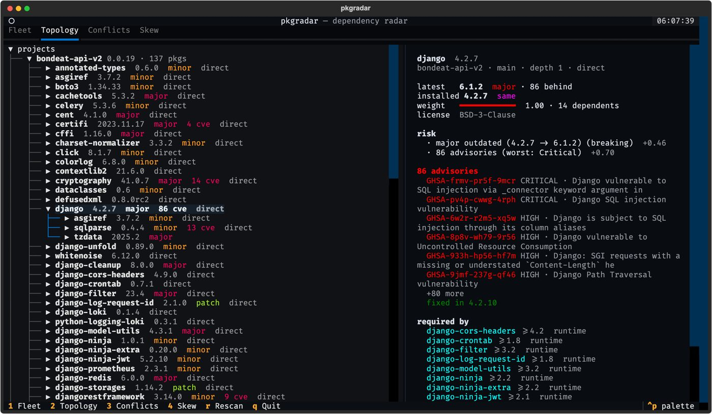
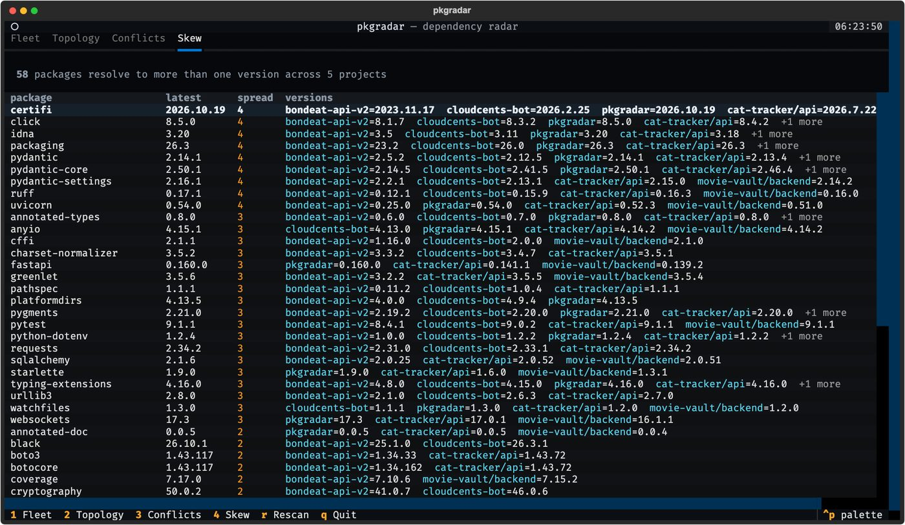

# pkgradar

**A dependency radar for local [uv](https://docs.astral.sh/uv/) projects.** Point it at a folder,
and it maps every `uv.lock` + `.venv` underneath: the full dependency graph, what each version is
pinned by, what has drifted from the lock, which packages are outdated or vulnerable, and which
versions disagree across projects.

One scanner, three ways in: a radar-style **web UI** with light and dark themes, a
**terminal UI**, and a one-shot **CLI report / JSON export**.

> Working on pkgradar? [AGENTS.md](AGENTS.md) documents the architecture, data flow,
> invariants, and change checklist for coding agents.



## What it answers

| Question | Where |
| --- | --- |
| Why is this package on this version? Who requires it? | Topology → click a node (blame chain, required-by) |
| What's the blast radius of a conflict? | Conflicts → constraint intersections with every parent spec |
| Is my venv actually in sync with `uv.lock`? | Conflicts → environment drift + `uv sync` plan |
| What's outdated, and by how much? | Packages → locked vs latest release on the configured index, semver delta, releases behind |
| Which releases have known CVEs? | Topology badges, Packages, Inspector (OSV advisories + fixed version) |
| Which packages disagree across my projects? | Skew → version spread per project |
| What's bloating this venv? | Packages/Projects → duplicates, orphaned installs, depth/weight |

## Screenshots

Radial topology for a focused project (16 direct deps), straight spokes from the project root:



Compact grid for large fan-outs — `bondeat-api-v2` declares **92 direct dependencies**, so the
layout switches to an aspect-matched wall automatically (`auto`):



The same views switch instantly between light and dark (the toggle lives in the top bar;
the first run follows your OS preference):




Outdated + advisory triage, worst first:



Cross-project version skew (green = newest, yellow = behind, red = oldest and behind):



Terminal UI — package tree with an inspector, plus conflicts and skew tabs:




## Requirements

- **Python 3.11+**
- **[uv](https://docs.astral.sh/uv/)** — required for the optional deep checks
  (`uv lock --check`, `uv sync --dry-run`) and expected for the projects it scans
- **Node.js 20+ and npm** — only needed to build or develop the web UI

pkgradar is read-only: it never installs, syncs, or edits the projects it scans.

## Quick start

```bash
# from this repo, no install
uv run --project . pkgradar serve --open

# or install it as a tool
uv tool install .
pkgradar serve ~/Documents/code --port 6767 --open
```

Then open <http://127.0.0.1:6767>.

```bash
pkgradar                       # alias for `serve` in the current directory
pkgradar scan ~/code           # one-shot rich report in the terminal
pkgradar scan ~/code --json report.json --quiet
pkgradar tui ~/code            # terminal UI
```

Scanning `~/Documents/code` (5 uv projects, 316 package instances) takes ~2s warm and ~14s cold,
mostly index/OSV network time. Results are cached under `~/.cache/pkgradar`.

### Flags

Unless marked otherwise, these apply to `scan` and `tui`. `serve` takes `root`,
`--host`, `--port`, `--open`, `--allow-remote`, and the index flags below. `tui`
also takes `--theme dark|light`.

| Flag | Effect |
| --- | --- |
| `--offline` | Use cached index data only, no network; OSV is skipped |
| `--no-enrich` | Skip all enrichment (index metadata and OSV) |
| `--no-advisories` | Skip OSV lookups |
| `--fast` | Skip `uv lock --check` and `uv sync --dry-run` |
| `--index-url URL` | Primary package index (default: `https://pypi.org/simple/`) |
| `--extra-index-url URL` | Additional index; may be repeated |
| `--index-api auto\|json\|simple` | Index protocol; `auto` tries JSON where useful then PEP 503 |
| `--trust-project-indexes` | Honor `[[tool.uv.index]]` in scanned `pyproject.toml` files |
| `--index-ca-bundle PATH` | CA bundle for a corporate/private index |
| `--index-timeout SECONDS` | Per-request index timeout (default: 25) |
| `--index-concurrency N` | Concurrent index requests (default: 12) |
| `--osv-include-private` | Send private-index package names to OSV (off by default) |
| `--theme dark\|light` | `tui` only: starting theme (also `PKGRADAR_THEME`) |

Index credentials are read from the URL, `UV_INDEX_<NAME>_USERNAME`/`_PASSWORD`
(or `UV_INDEX_USERNAME`/`_PASSWORD` for the primary), or `~/.netrc`. They are never
printed, cached, or returned by the API.

## Web UI

Hash-routed views, all backed by one `/api/scan` SSE stream. The top bar has a
light/dark toggle (persisted in `localStorage`; the first run follows your OS
preference), the active package index, and the offline/deep toggles. The graph
view is lazy-loaded, so Fleet and Packages stay fast even with a large dependency
graph. All views honour `prefers-reduced-motion`.

- **`#fleet`** — every project found under the root, with package, outdated, advisory and drift counts.
- **`#topology`** — React Flow + ELK graph. Layouts: `auto` (radial under ~26 visible nodes, otherwise
  compact grid), `radial`, `compact`, `layered`. Depth selector (`1…all`), group filter, outdated /
  advisory filters, search dimming, path highlight to the selected node, `+N hidden` to expand.
- **`#packages`** — sortable table: locked, latest, semver delta, CVEs, risk, dependents, installed, depth.
- **`#conflicts`** — constraint intersections and lock/venv drift; range conflicts include the blame chain.
- **`#skew`** — one row per package, one column per project.

The graph reads from the **lockfile** (resolution truth) and reconciles against **installed
`dist-info` metadata** (environment truth). When the two disagree, nodes are marked `missing` or
`version`; installed-only packages are reported as project-level drift.

## Terminal UI

```
1 Fleet   2 Topology   3 Conflicts   4 Skew   r Rescan   t Theme   q Quit
```

The TUI uses Textual's theme system, so `t` switches between light and dark.
`pkgradar tui --theme light` sets the starting theme, and `PKGRADAR_THEME=light`
does the same without a flag. The status line names the primary package index.

- **Fleet** — project table with venv interpreter, lock state, drift.
- **Topology** — collapsible dependency tree per project (capped at 2,000 nodes and depth 10);
  highlighting a package shows latest version, delta, installed version, risk factors, advisories
  (with fixed-in), and every package that requires it.
- **Conflicts / Skew** — the same data as the web tables.

Scanning happens in a background worker, so the UI stays responsive; `r` re-runs it.

## HTTP API

The web UI is a thin client over the scanner; the same data is available directly.

| Method / path | Purpose |
| --- | --- |
| `GET /api/health` | `{ok, version, root}` |
| `GET /api/defaults` | `{root, cwd, version, has_web, indexes, trust_project_indexes}` used by the SPA bootstrap |
| `GET /api/scan` | SSE stream; query params `root`, `offline`, `enrich`, `advisories`, `deep` |
| `GET /api/scan/result` | Same scan as a single JSON `ScanResult` (includes `indexes`) |
| `GET /api/docs` | FastAPI/OpenAPI docs |

Index configuration is **server-side only**: it comes from `pkgradar serve` flags or
environment variables. The API never accepts an index URL from the browser, so a
page cannot make the scanner request an arbitrary host.

The SSE stream emits `progress`, `project` (one project as soon as it is parsed),
`enrich`, `done` (the full `ScanResult`), and `error` events. A typical non-streaming
call:

```bash
curl 'http://127.0.0.1:6767/api/scan/result?root=/path/to/code&offline=true'
```

## Private package indexes

pkgradar can enrich packages from PyPI, a Nexus/Artifactory/devpi proxy, or any
PEP 503 simple index. Point it at the simple API root:

```bash
# Nexus Sonatype PyPI proxy
pkgradar scan ~/code \
  --index-url https://nexus.example.com/repository/pypi-proxy/simple/

# a private index plus public PyPI as a fallback
pkgradar scan ~/code \
  --index-url https://nexus.example.com/repository/pypi-proxy/simple/ \
  --extra-index-url https://pypi.org/simple/
```

`--index-url`/`--extra-index-url` also read `PKGRADAR_INDEX_URL`,
`PKGRADAR_EXTRA_INDEX_URL`, `UV_INDEX_URL` and `UV_EXTRA_INDEX_URL`. The primary
index comes from the CLI, then the environment, then PyPI; extras are appended in
CLI-then-environment order. For each package, the first index that has it wins
(`first-index` semantics), which avoids accidentally resolving a private name
from a public index. A hard error on the primary (auth, TLS, timeout) is reported
but does **not** fall through to a public extra index; only a real “not found”
does.

Prefer environment variables or `~/.netrc`; a credential embedded in the URL
also works, but command lines leak into shell history and process listings, so
pkgradar deliberately has no separate password flag:

```bash
export UV_INDEX_NEXUS_EXAMPLE_COM_USERNAME=deploy
export UV_INDEX_NEXUS_EXAMPLE_COM_PASSWORD=...

# or ~/.netrc
machine nexus.example.com login deploy password ...
```

pkgradar strips credentials before logging, caching, or returning JSON, and it
follows redirects only when the redirect stays on the same host as the index.
Prefer `https://` indexes: an `http://` index sends credentials in clear text on
the wire even though pkgradar never writes them to disk.

### Project-declared indexes

A scanned `pyproject.toml` may declare `[[tool.uv.index]]`. Because cloned
repositories are untrusted, those URLs are **ignored by default**. Opt in with
`--trust-project-indexes`; pkgradar then rejects loopback, link-local, and cloud
metadata hosts and reports any index it refuses.

```toml
[[tool.uv.index]]
name = "internal"
url = "https://nexus.example.com/repository/pypi-proxy/simple/"
default = true
```

### Protocol and privacy

- The client tries the legacy JSON API for PyPI (and for any index when
  `--index-api json` is set), then falls back to the PEP 503/PEP 691 simple
  endpoint used by Nexus. Private indexes use the simple endpoint by default.
- Simple-only indexes expose versions and `requires-python`; upload dates,
  licences, and summaries are shown as “—” because the protocol does not carry
  them.
- By default OSV is queried only for packages resolved from a public index.
  Private package names are not sent to `api.osv.dev`; use
  `--osv-include-private` if you want that.
- Caches are namespaced per index under `~/.cache/pkgradar/indexes/<hash>/`;
  the default PyPI cache keeps its historical `~/.cache/pkgradar/pypi/` path.

## Read-only by design

pkgradar never mutates your projects. It only runs:

- `uv lock --check` (whether the lock matches `pyproject.toml`)
- `uv sync --dry-run` (planned installs/uninstalls — advisory only, and only when the venv is trusted)
- plain reads of `uv.lock`, `pyproject.toml`, and `.venv/**/dist-info/METADATA`

No `uv add`, `uv lock`, `uv sync`, or `pip install` is ever invoked. The scanner also strips
`VIRTUAL_ENV`, `CONDA_PREFIX` and `PYTHONHOME` from child processes so a scan can't be redirected
into the wrong environment.

### Scanning untrusted code

A cloned repository can ship an executable at `.venv/bin/python`, and `uv` queries that interpreter
even for `lock --check` / `sync --dry-run`. pkgradar therefore:

- runs `uv lock --check` with `UV_PROJECT_ENVIRONMENT` pointed at a throwaway path outside the
  project, so uv never touches the project interpreter;
- never runs `uv pip list` / `uv pip check` (installed versions come from `dist-info`);
- skips `uv sync --dry-run` unless `.venv/bin/python` is a symlink that resolves outside the project
  (the normal POSIX venv layout). Windows venvs copy `python.exe`, so the sync plan is skipped there;
- ignores project-declared package indexes unless `--trust-project-indexes` is passed, and rejects
  loopback/link-local/metadata hosts in those indexes.

### Localhost trust model

`pkgradar serve` binds `127.0.0.1` and validates the `Host` header, which blocks DNS-rebinding
attacks from web pages. API requests carrying `Sec-Fetch-Site: cross-site` (or `same-site`) are
rejected, so a random website cannot drive-by trigger scans. The server has **no authentication**:
binding a non-loopback interface requires `--allow-remote` and exposes the read-only scanner (and
your local paths/package names) to your network. Put it behind an authenticating proxy if you need
remote access. Index URLs and credentials are server-side configuration; the browser can only pick
the scan root, not the index.

## How it works

```
src/pkgradar/
  discover.py   walk a root, find uv projects (pyproject + uv.lock + .venv)
  locks.py      parse uv.lock into nodes/edges; workspace + group handling
  venvs.py      dist-info METADATA, drift + sync plan (no interpreter execution)
  graph.py      BFS depths, orphans, cycles, root edges
  analyze.py    constraint intervals, conflict blame, risk score, cross-project skew
  indexes.py    index config, credential redaction, project-index trust, cache keys
  pypi.py       index client: PyPI JSON + PEP 503/691 simple, versions, disk cache
  osv.py        OSV querybatch advisories, per-package
  scanner.py    orchestration; emits progress/project/enrich/done events
  api.py        FastAPI + SSE + static web bundle + loopback guards
  cli.py        scan / serve / tui
  tui.py        Textual app
  models.py     Pydantic models; canonical JSON shape for the API + web types
  proc.py       subprocess helper; strips VIRTUAL_ENV/CONDA_PREFIX/PYTHONHOME
  utils.py      name/version/requirement parsing, semver delta, safe filenames
web/src/        React 19 + Vite + Tailwind v4 + @xyflow/react + elkjs + zustand
```

The scan is a pipeline: **discover → parse lock / declared graph → read venv dist-info and reconcile
drift → enrich from the configured indexes and OSV → compute conflicts, risk, skew, and stats**. The lockfile is
treated as resolution truth and `dist-info` as environment truth; a stale venv is reported as drift,
not as an unsatisfiable solver result.

Conflict detection computes the **allowed interval per parent specifier** (marker-aware, using
installed metadata when lock edges are ambiguous) and flags packages whose resolved version falls
outside a parent's constraint. Lock/venv drift is reconciled separately from solver errors, so a
stale venv doesn't masquerade as an unsatisfiable dependency set. Deep scans additionally run
`uv lock --check` and, when the venv interpreter is trustworthy, `uv sync --dry-run` to report the
exact install/uninstall plan.

The Pydantic models in `src/pkgradar/models.py` are the wire contract; `web/src/types.ts` mirrors
them. See [AGENTS.md](AGENTS.md) for the module-by-module data flow and change recipes.

## Development

```bash
# Python environment
uv sync

# Fast smoke scan: no index requests, no OSV, no uv subprocess checks
uv run pkgradar scan . --fast --no-enrich --no-advisories --quiet

# Web build (writes the committed bundle in src/pkgradar/webdist)
cd web && npm install && npm run build
cd .. && uv run pkgradar serve --open
```

For live frontend work, run the API and Vite side by side. Vite proxies `/api` to
`127.0.0.1:6767`, so the React app talks to a real scanner:

```bash
# terminal 1
uv run pkgradar serve . --port 6767

# terminal 2
cd web && npm run dev        # http://127.0.0.1:5173
```

`npm run build` runs `tsc --noEmit` and Vite. The compiled bundle is committed under
`src/pkgradar/webdist` so `uv tool install .` ships a working UI — rebuild it after
any `web/src` change. Do not edit the hashed files in `webdist` directly.

There is currently **no automated test suite or linter** configured; validate changes
with the smoke scan, `npm run build`, and a manual pass through the web UI / TUI.
[AGENTS.md](AGENTS.md) has the full validation checklist and the invariants to
preserve (read-only scanning, no interpreter execution, loopback trust model).

## Limitations

- Python/uv only. `pip`-only or Poetry projects are not discovered.
- Markers are evaluated using the running interpreter environment, overridden with the venv's
  Python version when available; optional/extra dependencies are shown but conflicts across
  mutually exclusive marker branches are intentionally not reported.
- Index/OSV enrichment is best-effort (cache + rate limits); use `--offline` for deterministic scans.
- Simple-only private indexes do not provide upload dates, licences, summaries, or development
  status, so those columns show “—”.
- `[[tool.uv.index]]` entries are ignored unless `--trust-project-indexes` is passed; untrusted
  project indexes are rejected if they point at loopback, link-local, or metadata hosts.
- OSV is skipped for packages resolved only from a private index unless `--osv-include-private`
  is passed, because package names are sensitive.
- pkgradar reports index provenance but does not resolve `[tool.uv.sources]`; `explicit` project
  indexes are ignored (with a warning) because their package sources are unknown. Other indexes are
  consulted in priority order.
- `uv sync --dry-run` output is advisory — pkgradar reports what uv *would* do, it never runs it.
  Plans are skipped when the project interpreter is not a trusted symlink (e.g. Windows venvs).
- Environment compatibility (`uv pip check`) is not evaluated, because it executes the project
  interpreter; the venv check field is reported as `unknown`.
- Projects with dozens of direct dependencies get dense overviews; use depth, group and search
  filters, or the compact/layered layouts.
